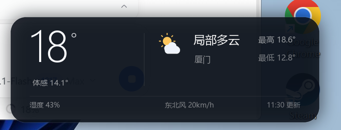

# 桌面天气 · 低温飘雪

> 一个常驻桌面的天气小组件：右下角显示实时气温，**气温够低时整个桌面开始飘雪**。
>
> A transparent Windows desktop weather widget that snows on your wallpaper when it gets cold.


纯 Python + Pillow 实现，不依赖 PyQt / Electron / 任何第三方 SDK；
天气数据来自 [Open-Meteo](https://open-meteo.com/)，免费且无需 API Key。

---

## 特性

- **桌面最底层**：窗口贴在壁纸之上、所有窗口之下，永远不会遮挡任何程序；点开任何窗口它就被盖住
- **可拖动**：按住卡片左键拖到任意位置，松手自动记住，下次启动还在原地
- **鼠标靠近才清晰**：鼠标不在卡片上时保持 ~70% 透明度，移上去自动变清晰
- **透明浮层**：Win32 分层窗口逐像素 alpha 合成，圆角、阴影、磨砂玻璃质感
- **鼠标点击穿透**：除卡片外全部穿透，不抢焦点、不进 Alt+Tab
- **实时天气**：当前温度、体感、天气状况、今日最高/最低、湿度、风向风速
- **自动定位**：IP 定位后反查中文地名，也可以手动指定城市
- **低温飘雪**：气温 ≤ 阈值（默认 3°C）时全屏飘雪，越冷雪越大；雪天天气也会触发
- **真实风向**：雪花按当前风向漂移，带阵风、摇摆和景深虚化，并带极淡投影（浅色窗口上也看得见）
- **高 DPI 友好**：Per-Monitor V2 感知，150% 缩放下文字依然清晰
- **省电**：被窗口盖住 / 不飘雪时停止重绘，几乎不占 CPU

---

## 快速开始

### 环境

- Windows 10 / 11
- Python 3.9+ 与 Pillow

```bash
pip install pillow
```

### 运行

双击 **`桌面天气.vbs`** 即可（无控制台窗口）。

第一次运行会在同目录生成：

| 文件 | 说明 |
| --- | --- |
| `config.json` | 配置文件（由 `config.example.json` 复制而来，已加入 `.gitignore`） |
| `location.json` | 定位缓存 |
| `weather.log` | 运行日志 |

> 启动脚本会自动在常见位置（Anaconda / 系统 Python / PATH）里寻找带 Pillow 的 `pythonw.exe`。

### 想立刻看雪花？

双击 **`预览飘雪效果.vbs`** 强制开启飘雪（与当前气温无关）。
如果程序已经在运行，这个脚本会直接把运行中的实例切换为飘雪模式。

---

## 快捷键

| 快捷键 | 功能 |
| --- | --- |
| `Ctrl + Alt + S` | 切换飘雪：自动 → 强制开启 → 关闭 |
| `Ctrl + Alt + R` | 立即刷新天气 |
| `Ctrl + Alt + H` | 显示 / 隐藏天气卡片（雪花保留） |
| `Ctrl + Alt + Q` | 退出程序 |

也可以双击 `停止桌面天气.vbs` 退出。

---

## 层级与透明度

程序默认以**桌面级最低优先级**运行（`"on_desktop": true`）：

- 窗口被沉到所有普通窗口之下，正好落在桌面图标层之上 —— 打开任何程序，它都会被盖住，**永远不会遮挡别的窗口**
- 点一下桌面（或 `Win + D`）就能重新看到它
- 鼠标不在卡片上时保持 **70% 透明度**（`idle_opacity`），鼠标移上去自动变清晰
- 被窗口完全盖住时会自动停止渲染，CPU 占用接近 0

如果希望它像普通悬浮窗一样永远置顶，把 `on_desktop` 改成 `false` 即可。

---

## 温度与雪花

默认 **≤ 3°C** 开始飘雪，越冷雪越大：

| 温度（相对阈值） | 效果 |
| --- | --- |
| 高于阈值 | 不飘雪，只有天气卡片 |
| 阈值 ~ 阈值−10°C | 雪量从 30% 逐渐增加到 100% |
| 当前天气本身是雪 / 阵雪 | 无论温度都飘雪（强度 55% 起） |



---

## 配置

把 `config.example.json` 复制为 `config.json` 后修改（改完重启程序生效）：

```json
{
  "city": "",
  "snow_threshold": 3.0,
  "snow_mode": "auto",
  "snow_density": 1.0,
  "position": "bottom-right",
  "pos_x": null,
  "pos_y": null,
  "margin": 28,
  "opacity": 0.92,
  "idle_opacity": 0.7,
  "on_desktop": true,
  "fps": 20,
  "auto_hide": false,
  "show_card": true,
  "refresh_minutes": 10
}
```

| 字段 | 说明 |
| --- | --- |
| `city` | 城市名，例如 `"上海"`；留空 = 自动定位 |
| `snow_threshold` | 飘雪温度阈值（°C），想常看到雪可以调高，比如 `15` |
| `snow_mode` | `auto` 按气温 / `on` 一直下雪 / `off` 不飘雪 |
| `snow_density` | 雪量倍率，`0.5` 稀疏，`2.0` 暴雪 |
| `position` | `bottom-right` / `bottom-left` / `top-right` / `top-left`；拖动卡片后自动变成 `custom` |
| `pos_x` / `pos_y` | 自定义位置（96 DPI 下的坐标，相对工作区左上角），由拖动自动写入，无需手改 |
| `margin` | 卡片距屏幕边缘的像素（按 96 DPI 计，随缩放自动放大） |
| `opacity` | 卡片底色不透明度 0~1 |
| `idle_opacity` | 鼠标不在卡片上时的不透明度，默认 `0.7`；设 `1` 可关闭淡出 |
| `on_desktop` | `true`（默认）贴在桌面最底层不遮挡窗口；`false` 改为置顶悬浮 |
| `fps` | 帧率，默认 20；调低更省电，调高更顺滑 |
| `auto_hide` | 置顶模式下的自动隐藏开关（桌面模式下不需要） |
| `show_card` | 是否显示天气卡片 |
| `refresh_minutes` | 天气刷新间隔（分钟） |

### 开机自启

双击 `开机自启-安装.vbs`（在「开始菜单 → 启动」创建快捷方式），
双击 `开机自启-卸载.vbs` 取消。

---

## 工作原理

- **透明浮层**：`WS_EX_LAYERED` 分层窗口 + `UpdateLayeredWindow`，Pillow 直接渲染出预乘 alpha 的
  BGRA 位图推给 DWM，一帧一次全屏合成。
- **桌面最底层**：去掉 `WS_EX_TOPMOST`，用 `SetWindowPos(HWND_BOTTOM)` 沉底，并在
  `WM_WINDOWPOSCHANGING` 里把任何 Z 序调整强制改回底部 —— 窗口最终正好压在 `Progman`（桌面）之上、
  所有普通窗口之下，所以既不遮挡程序，又能显示在壁纸上。
- **点击穿透**：`WS_EX_TRANSPARENT`；不抢焦点：`WS_EX_NOACTIVATE`；不进 Alt+Tab：`WS_EX_TOOLWINDOW`。
- **DPI**：`SetProcessDpiAwarenessContext(-4)`（Per-Monitor V2），按物理像素绘制。
- **天气**：`api.open-meteo.com`（当前温度 / 体感 / 天气代码 / 风向风速 / 今日最高最低）。
- **定位**：`ip-api.com`（失败时回退 `ipapi.co`），再用 Open-Meteo Geocoding 反查中文地名。
- **单实例**：命名互斥体；`预览飘雪效果.vbs` / `停止桌面天气.vbs` 通过
  `PostMessage(HWND_BROADCAST, ...)` 给已运行实例发命令。

---

## 常见问题

**提示找不到 Python / 没有 Pillow**
安装 Python 3.9+，命令行执行 `pip install pillow` 后重试。

**看不到卡片 / 雪花？**
这是默认行为 —— 它在桌面最底层，被任何窗口盖住时就看不见。
最小化窗口或按 `Win + D` 显示桌面即可看到。想让它永远置顶，把 `on_desktop` 改成 `false`。

**卡片好像变淡了？**
鼠标不在卡片上时是 70% 透明，移上去会变清晰。把 `idle_opacity` 设为 `1` 可关闭这个效果。

**桌面没有雪**
当前气温高于阈值（默认 3°C）。按 `Ctrl+Alt+S` 或双击 `预览飘雪效果.vbs` 预览。
另外雪花是白色的，在**纯白网页/窗口**上会比较淡——看桌面壁纸区域最清楚。

**CPU 有点高**
飘雪时约占用一个 CPU 核心的 40%（全屏 2240×1400 逐帧合成）。把 `fps` 调成 12~15，
或减小 `snow_density`。被窗口盖住时会自动停止渲染，平时几乎不耗电。

**想换个角落**
改 `position` 和 `margin`，重启程序。

---

## 许可

[MIT](LICENSE) © 2026 tianlianghaoge-qiu
