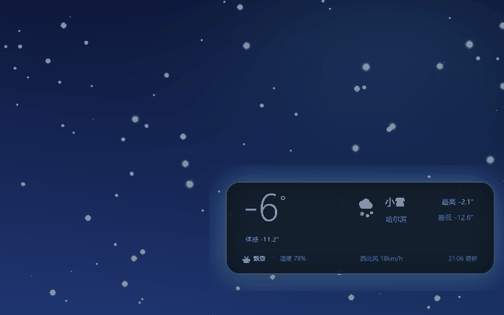

# 桌面天气 · 低温飘雪

> Windows 桌面天气组件：常驻桌面层显示实时气温，气温低于阈值时整个桌面飘雪。
>
> A transparent Windows desktop weather widget that snows on the wallpaper when it gets cold.



基于 Python 3 与 Pillow 实现，不依赖 Qt / Electron，也无需安装第三方 SDK。
天气数据取自 Open-Meteo，无需 API Key。

---

## 功能

- **桌面层常驻**：窗口位于壁纸之上、所有应用窗口之下，不遮挡任何程序；显示桌面即可看到
- **拖放定位**：按住卡片拖动至任意位置，松手自动保存，重启后保持原位
- **悬停聚焦**：指针离开卡片时保持 70% 不透明度，移入后恢复完全不透明
- **实时天气**：当前温度、体感温度、天气状况、今日最高/最低、湿度、风向风速
- **自动定位**：基于 IP 定位并反查中文地名，也支持手动指定城市
- **低温飘雪**：气温不高于阈值（默认 3°C）时全屏飘雪，雪量随温差增加；雨雪天气同样触发
- **风向联动**：雪花按实时风向漂移，叠加阵风、摇摆与景深虚化
- **点击穿透**：卡片以外的区域全部穿透，不抢焦点、不出现在 Alt+Tab
- **高 DPI 支持**：Per-Monitor V2 感知，缩放环境下按物理像素绘制
- **低开销**：内容无变化时不重绘；被窗口完全遮挡时暂停渲染

---

## 运行环境

| 项目 | 要求 |
| --- | --- |
| 操作系统 | Windows 10 / 11 |
| Python | 3.9 及以上 |
| 依赖 | Pillow |

```bash
pip install pillow
```

---

## 启动与退出

### 启动

双击 **`桌面天气.vbs`**，以无控制台方式启动。

启动器会自动在常见位置（Anaconda、系统 Python、`PATH`）中查找带有 Pillow 的 `pythonw.exe`，
找到后以隐藏窗口方式拉起 `desktop_weather.py`。程序为单实例运行，重复启动不会产生多个进程。

首次运行会在程序目录生成以下文件：

| 文件 | 说明 |
| --- | --- |
| `config.json` | 配置文件，由 `config.example.json` 初始化，已加入 `.gitignore` |
| `location.json` | 定位缓存与天气源记录 |
| `weather.log` | 运行日志，用于排查问题 |

### 退出

双击 `停止桌面天气.vbs`，或按 `Ctrl + Alt + Q`。程序会注销全局热键并销毁浮层后正常退出。

### 预览飘雪

双击 **`预览飘雪效果.vbs`** 可忽略当前气温强制开启飘雪。若程序已在运行，该脚本会向运行中的实例
发送切换命令，无需重启。

---

## 使用

### 快捷键

| 快捷键 | 功能 |
| --- | --- |
| `Ctrl + Alt + S` | 切换飘雪模式：自动 → 强制开启 → 关闭 |
| `Ctrl + Alt + R` | 立即刷新天气 |
| `Ctrl + Alt + H` | 显示 / 隐藏天气卡片（雪花保留） |
| `Ctrl + Alt + Q` | 退出程序 |

### 层级与透明度

默认以桌面级最低优先级运行（`"on_desktop": true`）：

- 窗口位于所有普通窗口之下，打开任何程序时都不会被遮挡问题困扰
- 按 `Win + D` 或最小化窗口后可见；此时程序会短暂置顶，以保证不被桌面层覆盖
- 指针离开卡片时降至 70% 不透明度（`idle_opacity`）
- 被窗口完全遮挡时停止渲染，CPU 占用接近 0

如需像普通悬浮窗一样始终置顶，将 `on_desktop` 设为 `false`。

### 温度与雪花

| 温度（相对阈值） | 效果 |
| --- | --- |
| 高于阈值 | 不飘雪，仅显示天气卡片 |
| 阈值 ~ 阈值 − 10°C | 雪量由 30% 递增至 100% |
| 天气本身为雪 / 阵雪 | 无论温度均飘雪（强度 55% 起） |


---

## 配置

将 `config.example.json` 复制为 `config.json` 后修改，重启程序生效：

```json
{
  "city": "",
  "snow_threshold": 3.0,
  "snow_mode": "auto",
  "snow_density": 1.0,
  "position": "bottom-right",
  "pos_x": null,
  "pos_y": null,
  "margin": 28,
  "opacity": 0.92,
  "idle_opacity": 0.7,
  "on_desktop": true,
  "fps": 20,
  "auto_hide": false,
  "show_card": true,
  "refresh_minutes": 10
}
```

| 字段 | 类型 | 默认值 | 说明 |
| --- | --- | --- | --- |
| `city` | string | `""` | 城市名，例如 `"上海"`；留空表示自动定位 |
| `snow_threshold` | number | `3.0` | 飘雪温度阈值（°C） |
| `snow_mode` | string | `"auto"` | `auto` 按气温 / `on` 始终飘雪 / `off` 关闭飘雪 |
| `snow_density` | number | `1.0` | 雪量倍率，`0.5` 稀疏，`2.0` 密集 |
| `position` | string | `"bottom-right"` | `bottom-right` / `bottom-left` / `top-right` / `top-left`；拖动后变为 `custom` |
| `pos_x` / `pos_y` | number\|null | `null` | 自定义位置，单位为 96 DPI 像素，相对工作区左上角；由拖动自动写入 |
| `margin` | number | `28` | 卡片与屏幕边缘的距离（96 DPI 像素，随缩放自动放大） |
| `opacity` | number | `0.92` | 卡片底色不透明度，0 ~ 1 |
| `idle_opacity` | number | `0.7` | 指针离开卡片时的不透明度；设为 `1` 可关闭淡出 |
| `on_desktop` | bool | `true` | `true` 位于桌面层不遮挡窗口；`false` 改为置顶悬浮 |
| `fps` | number | `20` | 渲染帧率，同时决定层级检查频率 |
| `auto_hide` | bool | `false` | 置顶模式下的自动隐藏开关 |
| `show_card` | bool | `true` | 是否显示天气卡片 |
| `refresh_minutes` | number | `10` | 天气刷新间隔（分钟） |

### 开机自启

运行 `开机自启-安装.vbs` 在「开始菜单 → 启动」创建快捷方式；运行 `开机自启-卸载.vbs` 取消。

---

## 实现原理

- **透明浮层**：`WS_EX_LAYERED` 分层窗口配合 `UpdateLayeredWindow`，Pillow 渲染预乘 alpha 的
  BGRA 位图并提交给 DWM，每帧一次全屏合成。
- **桌面层定位**：不使用 `WS_EX_TOPMOST`，通过 `SetWindowPos(HWND_BOTTOM)` 沉底，窗口最终位于
  `Progman` 之上、所有普通窗口之下；桌面完全露出时临时置顶，避免被桌面层覆盖。
- **点击穿透**：由 `WM_NCHITTEST` 逐点判定 —— 卡片区域返回 `HTCLIENT`（可点击、可拖动），其余区域
  返回 `HTTRANSPARENT`（继续穿透）。窗口同时设置 `WS_EX_NOACTIVATE` 与 `WS_EX_TOOLWINDOW`，
  不抢焦点、不进入 Alt+Tab。
- **DPI**：调用 `SetProcessDpiAwarenessContext(-4)`（Per-Monitor V2），按物理像素绘制。
- **天气**：优先请求 `api.open-meteo.com`；不可达时自动降级至 `wttr.in`，并将可用源与切换时间写入
  `location.json`，后续启动直接使用该源，30 分钟后重新探测 Open-Meteo。
- **定位**：`ip-api.com`（失败时回退 `ipapi.co`）获取经纬度，再经地理编码服务反查中文地名；
  地理编码同样支持降级。
- **单实例与进程间命令**：命名互斥体保证单实例；辅助脚本通过 `PostMessage(HWND_BROADCAST, ...)`
  向运行中的实例发送切换、刷新与退出命令。

---

## 常见问题

### 卡片或雪花不可见

程序运行在桌面层，被其他窗口覆盖时不可见。按 `Win + D` 或最小化窗口后即可看到。
如需始终可见，将 `on_desktop` 设为 `false`。

### 卡片显示偏淡

指针离开时默认降至 70% 不透明度。将 `idle_opacity` 设为 `1` 可禁用该效果。

### 桌面未出现飘雪

当前气温高于阈值。可调高 `snow_threshold`，或按 `Ctrl + Alt + S`、运行 `预览飘雪效果.vbs`
强制开启。白色雪花在纯白背景上对比度较低，在壁纸区域观察更明显。

### 启动后长时间显示「正在连接」

天气接口不可达。程序会自动切换至备用源；若两个源均失败，请检查网络与代理设置，错误详情记录于
`weather.log`。

### CPU 占用偏高

全屏飘雪时约占用单核 40%。可降低 `fps`（建议 12 ~ 15）或 `snow_density`。程序被窗口完全遮挡时
会暂停渲染。

### 提示缺少 Python 或 Pillow

未检测到可用的 Python 环境，或未安装 Pillow。安装 Python 3.9 及以上版本后执行
`pip install pillow`。

---

## 更新日志

| 版本 | 主要变更 |
| --- | --- |
| v1.1.1 | 天气源自动降级（Open-Meteo → wttr.in），缩短超时与重试间隔 |
| v1.1.0 | 桌面层常驻、卡片拖放定位、悬停半透明、显示桌面时不再消失 |
| v1.0.0 | 首个版本：实时天气卡片与低温飘雪 |

---

## 许可

[MIT](LICENSE) © 2026 tianlianghaoge-qiu
